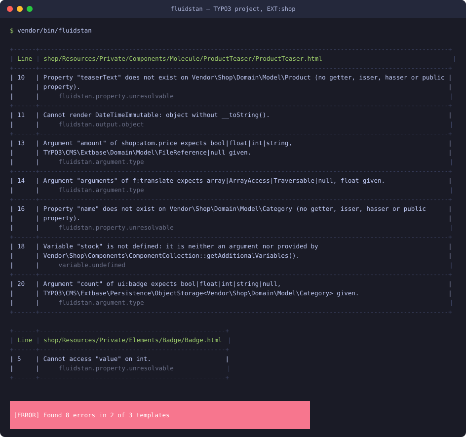

# FluidStan for TYPO3

<picture>
  <source media="(prefers-color-scheme: dark)" srcset="docs/logo-dark.svg">
  
</picture>

<a href="https://www.flowd.de">
  <picture>
    <source media="(prefers-color-scheme: dark)" srcset="https://www.flowd.de/assets/logo/flowd-logo-white.svg">
    
  </picture>
</a>

<hr />

TYPO3 integration for [FluidStan](https://github.com/fluidstan/fluidstan), the static analyser for Fluid
templates and components powered by [PHPStan](https://phpstan.org). Developed and maintained by
[Flowd GmbH](https://flowd.de).

<p>
  <a href="https://github.com/fluidstan/typo3/actions/workflows/ci.yml"></a>
  <a href="https://packagist.org/packages/fluidstan/typo3"></a>
  <a href="LICENSE"></a>
</p>



FluidStan analyses Fluid templates without rendering them and reports property paths that do not exist
on the model, values that cannot be rendered, loops over non-iterables, wrong ViewHelper and component
argument types, undefined variables, unknown slots and more. The screenshot shows the analysis of
[`docs/example`](docs/example), a small `shop` extension with an Extbase model and two components: a typo
in a property path, a `DateTimeImmutable` rendered without formatting, a file reference passed where a
number is expected, a float passed to the `arguments` of `f:translate`, a missing getter on a related
category read through an `ObjectStorage`, and an undefined variable. Run it yourself with
`composer fluidstan:example`.

This package makes FluidStan work inside a TYPO3 project:

- **Boots TYPO3** like a CLI command, without opening a database connection, so the dependency
  injection container, extension paths and configuration are available while templates are parsed.
- **Registers TYPO3's global Fluid namespaces** exactly as TYPO3 assembles them: `f` includes
  `TYPO3\CMS\Fluid\ViewHelpers`, and every `Configuration/Fluid/Namespaces.php` (TYPO3 14.1),
  `$GLOBALS['TYPO3_CONF_VARS']['SYS']['fluid']['namespaces']` and the `ModifyNamespacesEvent` are honoured.
- **Resolves `EXT:` paths** in the configuration, so templates are addressed the TYPO3 way.

Supports TYPO3 13.4 and 14 on PHP 8.2 or newer, in Composer mode.

## Installation

```bash
composer require --dev fluidstan/typo3
```

The core package comes along as a dependency.

## Configuration

`fluidstan.neon` in the project root, next to `composer.json`:

```neon
parameters:
    environment: FluidStan\TYPO3\Typo3Environment
    bootstrapFiles:
        - vendor/autoload.php
    paths:
        - EXT:my_site/Resources/Private/Components
        - EXT:my_site/Resources/Private/Templates
    namespaces:
        my: My\Site\Components\ComponentCollection
    tmpDir: var/cache/fluidstan
    phpstan:
        level: 8
```

- `environment` activates this package.
- `bootstrapFiles` must include the project's autoloader; TYPO3 is booted from it.
- `paths` take `EXT:` notation or paths relative to the configuration file.
- `namespaces` lists component collections and ViewHelper namespaces that are not registered globally
  in TYPO3, for example a collection a TYPO3 13 project registers only in `ext_localconf.php`. A
  component collection is given by its class name. Globally registered namespaces need no entry.
- `tmpDir` holds the generated code and PHPStan's cache; keep it out of version control.

Then run the analysis:

```bash
vendor/bin/fluidstan
vendor/bin/fluidstan -c Build/fluidstan.neon   # configuration elsewhere
vendor/bin/fluidstan --error-format=json       # for CI tooling
```

Run it where TYPO3 runs. In a Docker or DDEV setup that is the PHP container, because the boot reads
`config/system/settings.php` and `additional.php`, loads every extension's `ext_localconf.php` and builds
the dependency injection container like any other TYPO3 CLI command. No database connection is opened.
Without a `settings.php` TYPO3 only offers its failsafe mode, which knows the system extensions alone, so
FluidStan stops with a message; a minimal `settings.php` with `SYS/encryptionKey` is enough.

## What gets typed

- **Components** declare their argument types with `f:argument`; FluidStan checks every use against the
  PHP classes behind them, including your Extbase models, DTOs and value objects.
- **Plain templates, partials and layouts** have `mixed` variables unless you declare them with an
  annotation, which is also the way to type `{settings}`, `{data}` or anything else a controller assigns:

  ```html
  <f:comment>
      @var My\Site\Domain\Model\Product product
      @var array<string, mixed> data
  </f:comment>
  ```

- **ViewHelper arguments** are validated against the ViewHelper's argument definitions with the rules
  Fluid 5 applies at runtime. ViewHelpers that take services through their constructor are instantiated
  without the constructor to read their definitions, which is sufficient for the core and most extensions.

## Roadmap

- Typed TYPO3 variables out of the box: `{settings}`, `{data}`, `{page}`, `{site}`, `{language}`,
  `{request}`
- Content Blocks field definitions as the type of `{data}` and of content element component arguments
- Partials and layouts resolved through TYPO3's template paths from site sets and TypoScript
- ViewHelper instantiation through the dependency injection container
- Extbase relations: `ObjectStorage` and lazy-loading proxies unwrapped to their element types

## Development

```bash
composer install          # installs TYPO3 (typo3/minimal) and the example extension for the test suite
composer fluidstan:example # analyse docs/example
composer check            # everything below
composer lint             # syntax, composer.json, php-cs-fixer, PHPStan (max, strict, phpstan-typo3), Rector, dependency analysis
composer fix              # apply Rector, php-cs-fixer and composer normalize
composer test             # PHPUnit
```

Booting TYPO3 from the outside goes through `SystemEnvironmentBuilder`, which TYPO3 marks as internal;
the same route typo3-console and the testing framework take. The package root is a minimal TYPO3 project
with `config/system/settings.php`, so the example can be analysed and the integration test boots TYPO3
for real. CI runs the suite on PHP 8.2 to 8.5 against TYPO3 13.4 and 14.
